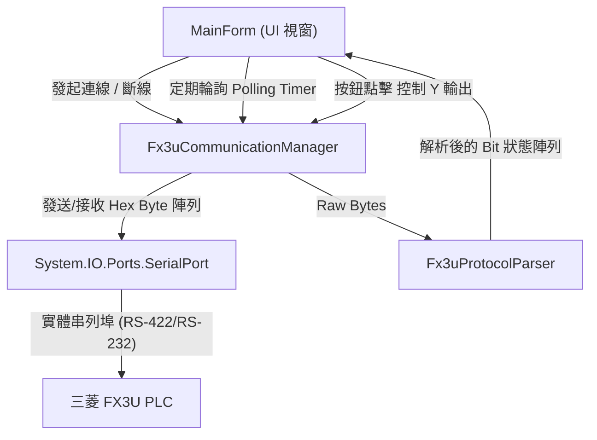

# 三菱 PLC (FX3U) 監控系統軟體規格書

**文件版本**：V1.0  
**制定日期**：2026-09-22  
**開發環境**：Visual Studio 2026 / C# Windows Forms (.NET Framework 4.8 或 .NET 8/9-windows)  
**目標硬體**：Mitsubishi MELSEC-F FX3U 系列 PLC  

---

## 1. 系統概述

本專案旨在透過 C# Windows Forms 視窗應用程式，經由 RS-232 / RS-422 (USB-SC09-FX 通訊線) 與三菱 FX3U PLC 進行串列通訊 (Serial Port)。  
提供上位機對 PLC 輸入接點 ($X0 \sim X17$) 與輸出接點 ($Y0 \sim Y17$) 的**即時狀態監控**，並具備對輸出接點 ($Y0 \sim Y17$) 的**單點強制 ON/OFF 控制功能**。

---

## 2. 硬體通訊介面規格

### 2.1 串列通訊參數 (Serial Port Settings)
| 參數項目 | 設定值 | 說明 |
| :--- | :--- | :--- |
| **通訊介面** | RS-232 / USB-SC09 (虛擬 COM 埠) | 連接 PLC Programming Port (圓頭 8-pin DIN) |
| **鮑率 (Baud Rate)** | **9600 bps** | 固定傳輸速率 |
| **資料位元 (Data Bits)** | **7 bits** | 7 位元資料長度 |
| **同位檢查 (Parity)** | **Even (偶同位)** | 偶數同位校驗 |
| **停止位元 (Stop Bits)** | **1 bit** | 1 位停止位元 |
| **流量控制 (Flow Control)** | None | 無硬體握手流控 |
| **讀寫超時 (Timeout)** | Read: 1000ms / Write: 500ms | 避免 UI 線程阻塞 |

---

## 3. FX 程式口通訊協定 (FX Programming Port Protocol)

### 3.1 封包格式定義
通訊協定採用 ASCII 封包傳輸，主要控制字元定義如下：
- `STX` (0x02)：封包起始碼。
- `ETX` (0x03)：資料本文結束碼。
- `ACK` (0x06)：PLC 正確回應碼（強制控制命令回傳）。
- `NAK` (0x15)：PLC 通訊錯誤或檢查碼不符。
- `SUM` (2 Bytes ASCII)：檢查碼，為從指令碼起算至 `ETX` 止之所有 Byte 相加，取低 8 位元之十六進制 ASCII 字元。

#### Checksum 計算公式
$$\text{Checksum} = \left( \sum_{i=\text{CMD}}^{\text{ETX}} \text{Byte}_i \right) \pmod{256}$$
計算出之 1 Byte 轉為 2 個 ASCII 字元（大寫十六進制）。

---

## 4. 指令與資料解析規範

### 4.1 讀取輸出接點狀態 ($Y0 \sim Y17$)
- **發送指令 (Hex)**：
  ```
  02 30 30 30 41 30 30 32 03 36 36
  ```
  - `02`：STX
  - `30`：指令碼 `'0'` (批次讀取位元/暫存器)
  - `30 30 41 30`：元件內部首地址（ASCII Hex: `"00A0"`，對應 FX 系列 Y 接點群組）
  - `30 32`：讀取長度（ASCII Hex: `"02"`，代表讀取 2 個 Byte，共 16 點）
  - `03`：ETX
  - `36 36`：CheckSum ASCII `"66"`

- **PLC 回傳格式**：
  ```
  02 [Byte1] [Byte2] [Byte3] [Byte4] 03 [Sum1] [Sum2]
  ```
  例如範例資料：
  ```
  02 35 35 38 34 03 43 33
  ```
  - `35` (ASCII `'5'`)：代表 $Y4 \sim Y7$ (Nibble 1)
  - `35` (ASCII `'5'`)：代表 $Y0 \sim Y3$ (Nibble 0)
  - `38` (ASCII `'8'`)：代表 $Y14 \sim Y17$ (Nibble 3)
  - `34` (ASCII `'4'`)：代表 $Y10 \sim Y13$ (Nibble 2)
  - `03`：ETX
  - `43 33`：CheckSum ASCII `"C3"`

#### 位元對照與解碼對應表 (八進制點位)
| 回傳位元組序 | ASCII 字元 | 數值 | Bit 3 | Bit 2 | Bit 1 | Bit 0 |
| :--- | :--- | :--- | :--- | :--- | :--- | :--- |
| **第 2 個 Byte** | `'5'` (0x35) | 5 (0101b) | **Y3: OFF** | **Y2: ON** | **Y1: OFF** | **Y0: ON** |
| **第 1 個 Byte** | `'5'` (0x35) | 5 (0101b) | **Y7: OFF** | **Y6: ON** | **Y5: OFF** | **Y4: ON** |
| **第 4 個 Byte** | `'4'` (0x34) | 4 (0100b) | **Y13: OFF** | **Y12: ON** | **Y11: OFF** | **Y10: OFF** |
| **第 3 個 Byte** | `'8'` (0x38) | 8 (1000b) | **Y17: ON** | **Y16: OFF** | **Y15: OFF** | **Y14: OFF** |

> **解碼規則說明**：
> 1. 將讀取到的 ASCII 碼轉為整數數值 $V$（例：`'5'` $\rightarrow 5$）。
> 2. 以二進制位元判定狀態：$\text{Bit } k = (V \gg k) \ \& \ 1$。
> 3. 第 2 Byte 掌管 $Y0 \sim Y3$；第 1 Byte 掌管 $Y4 \sim Y7$。
> 4. 第 4 Byte 掌管 $Y10 \sim Y13$；第 3 Byte 掌管 $Y14 \sim Y17$。

---

### 4.2 讀取輸入接點狀態 ($X0 \sim X17$)
- **發送指令 (Hex)**：
  ```
  02 30 30 30 38 30 30 32 03 35 44
  ```
  - `30 30 38 30`：元件內部首地址（ASCII Hex: `"0080"`，對應 FX 系列 X 接點群組）
  - `30 32`：讀取 2 個 Byte
  - `35 44`：CheckSum ASCII `"5D"`

- **PLC 回傳格式**：
  ```
  02 [Byte1] [Byte2] [Byte3] [Byte4] 03 [Sum1] [Sum2]
  ```
  以回傳 `02 35 35 38 34 03 43 33` 為例：
  - 第 2 個 Byte (`'5'` = 0101b) $\rightarrow$ **X0: ON, X1: OFF, X2: ON, X3: OFF**
  - 第 1 個 Byte (`'5'` = 0101b) $\rightarrow$ **X4: ON, X5: OFF, X6: ON, X7: OFF**
  - 第 4 個 Byte (`'4'` = 0100b) $\rightarrow$ **X10: OFF, X11: OFF, X12: ON, X13: OFF**
  - 第 3 個 Byte (`'8'` = 1000b) $\rightarrow$ **X14: OFF, X15: OFF, X16: OFF, X17: ON**

---

### 4.3 強制控制 Y 點輸出 (Bit Set / Reset 指令)
- **指令格式說明**：
  - 強制 ON 指令碼：`0x37` (ASCII `'7'`)
  - 強制 OFF 指令碼：`0x38` (ASCII `'8'`)
  - PLC 正確執行後，回傳 1 個 Byte：`0x06` (ACK)。

#### 完整 Y0 ~ Y17 控制指令對照表
| 接點 | 強制 ON 指令 (Hex) | 強制 OFF 指令 (Hex) |
| :--- | :--- | :--- |
| **Y0** | `02 37 30 30 30 35 03 46 46` | `02 38 30 30 30 35 03 30 30` |
| **Y1** | `02 37 30 31 30 35 03 30 30` | `02 38 30 31 30 35 03 30 31` |
| **Y2** | `02 37 30 32 30 35 03 30 31` | `02 38 30 32 30 35 03 30 32` |
| **Y3** | `02 37 30 33 30 35 03 30 32` | `02 38 30 33 30 35 03 30 33` |
| **Y4** | `02 37 30 34 30 35 03 30 33` | `02 38 30 34 30 35 03 30 34` |
| **Y5** | `02 37 30 35 30 35 03 30 34` | `02 38 30 35 30 35 03 30 35` |
| **Y6** | `02 37 30 36 30 35 03 30 35` | `02 38 30 36 30 35 03 30 36` |
| **Y7** | `02 37 30 37 30 35 03 30 36` | `02 38 30 37 30 35 03 30 37` |
| **Y10**| `02 37 30 38 30 35 03 30 37` | `02 38 30 38 30 35 03 30 38` |
| **Y11**| `02 37 30 39 30 35 03 30 38` | `02 38 30 39 30 35 03 30 39` |
| **Y12**| `02 37 30 41 30 35 03 31 30` | `02 38 30 41 30 35 03 31 31` |
| **Y13**| `02 37 30 42 30 35 03 31 31` | `02 38 30 42 30 35 03 31 32` |
| **Y14**| `02 37 30 43 30 35 03 31 32` | `02 38 30 43 30 35 03 31 33` |
| **Y15**| `02 37 30 44 30 35 03 31 33` | `02 38 30 44 30 35 03 31 34` |
| **Y16**| `02 37 30 45 30 35 03 31 34` | `02 38 30 45 30 35 03 31 35` |
| **Y17**| `02 37 30 46 30 35 03 31 35` | `02 38 30 46 30 35 03 31 36` |

---

## 5. 控制面板說明

本系統對應之機電整合控制面板具備以下操作元件與燈號：

| 名稱 | 說明 | 類型 | 對應接點 |
| :--- | :--- | :--- | :--- |
| **ST/RST** | 在工作模式做為啟動用，而在復歸模式時做為復歸用 | 復歸式按鈕開關 | X16 |
| **EMS** | 作為緊急停止之用 (需使用 NC 接點) | 壓扣式按鈕開關 | X17 |
| **COS1** | 作為選擇「復歸模式」/「工作模式」之用 | 二段切換式選擇開關 | X13 |
| **COS2** | 作為選擇「指定功能」/「單一循環」/「連續循環」之用 | 三段切換式選擇開關 | X14, X15 |
| **RL** | 紅色指示燈，運轉時亮，待機時滅，代表運轉燈 | 指示燈 (紅色) | Y15 |
| **GL** | 綠色指示燈，待機時亮，運轉時滅，代表待機燈 | 指示燈 (綠色) | Y17 |
| **YL** | 黃色指示燈，復歸中 0.5 秒亮 / 0.5 秒滅閃爍，代表復歸燈 | 指示燈 (黃色) | Y16 |

---

## 6. 機構 I/O 配置表 (11501 氣壓與馬達搬運機構)

### 6.1 輸入接點配置 ($X0 \sim X17$)
| PLC 位址 | 元件編號 | 註釋說明 | 元件類別 |
| :--- | :--- | :--- | :--- |
| **X0** | **a1** | 垂直缸上端點 | 極限開關 (Sensor) |
| **X1** | **a0** | 垂直缸下端點 | 極限開關 (Sensor) |
| **X2** | **b1** | 迴轉缸進料端點 | 極限開關 (Sensor) |
| **X3** | **b0** | 迴轉缸出料端點 | 極限開關 (Sensor) |
| **X4** | **c0** | 氣壓夾爪開極限點 | 極限開關 (Sensor) |
| **X5** | **ps1** | 真空吸盤壓力開關 | 壓力感測開關 |
| **X6** | **e1** | 迴轉馬達正轉端點 | 位置端點開關 |
| **X7** | **e0** | 迴轉馬達反轉端點 | 位置端點開關 |
| **X10** | **s0** | 進料感測器 | 光電/接近感測器 |
| **X11** | **s1** | 姿勢感測器 | 物件姿態感測器 |
| **X12** | **s2** | 顏色感測器 | 物件顏色辨識感測器 |
| **X13** | **COS1** | *復歸模式 / 工作模式 | 切換開關 (2段) |
| **X14** | **COS2_L** | *單一循環 / 指定功能 | 切換開關 (3段-左) |
| **X15** | **COS2_R** | *單一循環 / 連續循環 | 切換開關 (3段-右) |
| **X16** | **ST/RST** | 啟動鈕 / 復歸鈕 | 復歸式按鈕 |
| **X17** | **EMS** | 緊急停止開關 (NC 接點) | 壓扣式急停鈕 |

### 6.2 輸出接點配置 ($Y0 \sim Y17$)
| PLC 位址 | 元件編號 | 註釋說明 | 元件類別 / 驅動目標 |
| :--- | :--- | :--- | :--- |
| **Y0** | **A＋** | 垂直缸上升 | 氣壓電磁閥 (SOL A+) |
| **Y1** | **A－** | 垂直缸下降 | 氣壓電磁閥 (SOL A-) |
| **Y2** | **B** | 迴轉缸轉至進料端 | 氣壓電磁閥 (SOL B) |
| **Y3** | **C＋** | 氣壓夾爪夾料 | 氣壓電磁閥 (SOL C+) |
| **Y4** | **C－** | 氣壓夾爪放鬆 | 氣壓電磁閥 (SOL C-) |
| **Y5** | **D＋** | 真空吸盤吸 | 真空產生電磁閥 (SOL D+) |
| **Y6** | **R1** | 迴轉馬達正轉 (M＋) | 馬達正轉接觸器/驅動器 |
| **Y7** | **R2** | 迴轉馬達反轉 (M－) | 馬達反轉接觸器/驅動器 |
| **Y10** | **D－** | 真空吸盤放 | 破真空電磁閥 (SOL D-) |
| **Y11** | - | (備用接點) | 預留 |
| **Y12** | - | (備用接點) | 預留 |
| **Y13** | - | (備用接點) | 預留 |
| **Y14** | - | (備用接點) | 預留 |
| **Y15** | **RL** | 紅燈 (運轉燈，運轉時亮，待機時滅) | 面板指示燈 (紅色) |
| **Y16** | **YL** | 黃燈 (復歸燈，復歸中 0.5s/0.5s 閃爍) | 面板指示燈 (黃色) |
| **Y17** | **GL** | 綠燈 (待機燈，待機時亮，運轉時滅) | 面板指示燈 (綠色) |

---

## 7. 機構動作程序規格 (機電整合丙級第二站)

### 7.1 待機狀態
機構回到機械原點：
- **垂直導桿滑台在下位**（$X1=a0$ 感應到位）。
- **迴轉缸在出料位**（$X3=b0$ 感應到位）。
- **夾爪 C 水平張開**（$X4=c0$ 感應到位）。
- **迴轉馬達 M 停止**。
- 未啟動執行任何模式與功能，**待機燈 GL ($Y17$) 亮，運轉燈 RL ($Y15$) 滅**。

### 7.2 工作模式動作功能 (選擇開關 COS1 切至「工作模式」$X13=\text{OFF}$)

#### 1. 單一循環 (COS2 切至「單一循環」$X14=\text{OFF}, X15=\text{OFF}$)
1. 在待機狀態時，按下 **ST/RST ($X16$)** 啟動鈕：
   - 運轉燈 **RL ($Y15$) 亮**，待機燈 **GL ($Y17$) 滅**。
2. 人工將圓料放至進料座位置（感測器 $X10=s0$ 感測到料件）。
3. 機械執行一個料件之單一循環，依不同工件特性執行對應程序：
   - **(a) 紅色圓料開口朝上 ($X11=s1$ 朝上, $X12=s2$ 紅色)**：
     - 由迴轉旋臂真空吸盤吸取（$Y5=D+$），送至出料座位置（$Y2=B$ 轉至出料位），破真空（$Y10=D-$）排料。
   - **(b) 紅色圓料開口朝下 ($X11=s1$ 朝下, $X12=s2$ 紅色)**：
     - 先由垂直導桿滑台上升/下降配合氣壓夾爪（$Y3=C+$）夾取翻轉，使圓孔朝上並張開夾爪（$Y4=C-$）。
     - 再由迴轉旋臂真空吸盤吸取，送至出料座位置排料。
   - **(c) 黑色圓料開口朝上 ($X11=s1$ 朝上, $X12=s2$ 黑色)**：
     - 進料檢測為黑色圓料時，**運轉紅燈 RL ($Y15$) 變更為以 0.5 秒亮 / 0.5 秒滅閃爍**表示，直到排料為止。
     - 迴轉旋臂真空吸盤吸取並送至出料座排料。
   - **(d) 黑色圓料開口朝下 ($X11=s1$ 朝下, $X12=s2$ 黑色)**：
     - **運轉紅燈 RL ($Y15$) 以 0.5 秒閃爍**。
     - 由氣壓夾爪夾取翻轉使圓孔朝上，再由迴轉旋臂真空吸盤吸取，送至出料座位置排料。
   - **(e) 完成排料後**：
     - 機構回到機械原點，回復待機狀態，**待機燈 GL ($Y17$) 亮，運轉燈 RL ($Y15$) 滅**。

#### 2. 連續循環 (COS2 右切至「連續循環」$X15=\text{ON}$)
1. 在待機狀態時，按下 **ST/RST ($X16$)** 啟動鈕，執行連續循環功能。
2. 每個循環內所執行的動作與「單一循環」相同。
3. 每次放一個料件至進料處（圓料開口不按次序放入），機構回機械原點後，立即（進料延遲 3~5 秒）自動執行下一個料件的動作。
4. **無料終止判定**：
   - 若無料件放入，運轉燈 RL ($Y15$) 繼續亮著維持等待。
   - 若 **10 秒後** 有/無料感測器 $s0$ ($X10$) 仍未感測到料件，運轉燈 RL 滅、待機燈 GL 亮，自動終止連續循環並回到待機狀態。

#### 3. 翻料功能 (COS2 左切至「指定功能」$X14=\text{ON}$)
1. 在待機狀態時，每按下一次 **ST/RST ($X16$)** 鈕：
   - 運轉燈 **RL ($Y15$) 閃爍**，待機燈 **GL ($Y17$) 滅**。
2. 垂直導桿滑台與旋轉夾爪機構模組相互配合執行一次翻料動作（翻轉開口朝下或朝上）。
3. 直到翻料完成，回復**待機燈 GL 亮，運轉燈 RL 滅**。

### 7.3 緊急停止功能 (EMS $X17$)
1. 當按下緊急停止鈕 **EMS ($X17$)** 時（NC 接點斷開），系統立即停止運轉（電磁閥、馬達皆斷電）。
2. **工件保持安全機制**：
   - 若真空吸盤有吸取料件，或氣壓夾爪有夾持料件，**必須繼續保持吸取或夾持，不可使工件掉落損壞**。
3. **互鎖保護**：
   - 在解除緊急停止鈕 EMS 之前，壓按 ST/RST 鈕皆無效。

### 7.4 復歸模式動作功能 (選擇開關 COS1 左切至「復歸模式」$X13=\text{ON}$)
1. 解除緊急停止鈕 EMS 後，將 COS1 左切至「復歸模式」。
2. 按下 **ST/RST ($X16$)** 鈕，機械依序安全回原點位置：
   - 復歸燈 **YL ($Y16$) 以 0.5 秒亮 / 0.5 秒滅閃爍 3 秒或以上**。
   - 待所有機構回到機械原點（下位、出料位、夾爪張開、馬達停止）後自動停止。
3. 若未完全回到機械原點，機械鎖定無法啟動，確保過程中不可發生任何機構碰撞現象。

---

## 8. 系統架構與程式模組設計

本專案採分層架構設計，將通訊協定底層與使用者介面 (UI) 解耦，提高維護性與穩定度。



### 5.1 模組劃分
1. **`Fx3uCommunicationManager.cs`**
   - 管理 `SerialPort` 的生命週期（開啟、關閉、配置）。
   - 封裝通訊鎖 (`object _lock`)，確保輪詢與手動觸發指令不會發生串線衝突。
   - 提供同步/非同步的封包傳輸介面 (`SendCommandAndReceive`)。
2. **`Fx3uProtocolParser.cs`**
   - 負責驗證 Checksum。
   - 解析 PLC 回傳之 8 位元組資料 (`02 ... 03 CS1 CS2`)。
   - 轉換 ASCII Hex 碼為布林陣列 (`bool[16]`)，分別對應 16 點接點狀態。
3. **`MainForm.cs`**
   - 提供直觀現代化的工業控制介面。
   - 串列埠選擇 (下拉選單自動列舉 `SerialPort.GetPortNames()`)。
   - 即時指示燈 (LED Indicator) 呈現 $X0 \sim X17$ 與 $Y0 \sim Y17$ 狀態。
   - 提供 $Y0 \sim Y17$ 的 ON/OFF 切換按鈕。
   - TX/RX Raw Data 監視日誌區（供除錯與通信檢視）。

---

## 9. 使用者介面 (UI/UX) 規格規劃

### 9.1 視窗區塊劃分
| 區塊編號 | 區塊名稱 | 元件與功能說明 |
| :--- | :--- | :--- |
| **Zone 1** | **通訊連線與控制區** | 包含 COM 埠選單、連線/中斷按鈕、離線模擬開關、**「機丙二開始」自動運行按鈕**、連線狀態燈。 |
| **Zone 2** | **輸入點監控區 ($X0 \sim X17$)** | 16 組 LED 圓形指示燈與詳細機構名稱標籤，即時反映感測器/開關訊號。 |
| **Zone 3** | **輸出點監控與控制區 ($Y0 \sim Y17$)** | 16 組 LED 圓形指示燈（紅/黃/綠/橘）與詳細動作標籤，搭配單點強制 ON/OFF 控制按鈕。 |
| **Zone 4** | **監控週期設定區** | 輪詢週期調整 (NumericUpDown，預設 200ms)、自動輪詢開關 (CheckBox)。 |
| **Zone 5** | **通訊紀錄視窗 (Log Monitor)** | RichTextBox 顯示即時發送/接收之 Hex 字串與時間戳記，具備「清除記錄」功能。 |

---

## 10. 關鍵演算法實作參考 (C#)

### 10.1 Checksum 驗證演算法
```csharp
public static bool VerifyChecksum(byte[] buffer, int length)
{
    // 檢查基本結構: 起始為 0x02，倒數第三個為 0x03
    if (length < 4 || buffer[0] != 0x02 || buffer[length - 3] != 0x03)
        return false;

    // 計算 STX 之後到 ETX (包含 ETX) 的總和
    int sum = 0;
    for (int i = 1; i <= length - 3; i++)
    {
        sum += buffer[i];
    }
    byte calculatedSum = (byte)(sum & 0xFF);

    // 取得回傳中的 2 Bytes ASCII Checksum
    string receivedSumStr = Encoding.ASCII.GetString(buffer, length - 2, 2);
    string calculatedSumStr = calculatedSum.ToString("X2");

    return receivedSumStr.Equals(calculatedSumStr, StringComparison.OrdinalIgnoreCase);
}
```

### 10.2 回傳資料解碼為 Bit 狀態 ($X$ 或 $Y$)
```csharp
public static bool[] ParseBitStatus(byte[] rxData)
{
    // rxData 格式: [02] [Byte1] [Byte2] [Byte3] [Byte4] [03] [CS1] [CS2]
    // 範例值: 0x35 ('5'), 0x35 ('5'), 0x38 ('8'), 0x34 ('4')
    bool[] status = new bool[16];

    char c1 = (char)rxData[1]; // High nibble (Y4~Y7 / X4~X7)
    char c0 = (char)rxData[2]; // Low nibble  (Y0~Y3 / X0~X3)
    char c3 = (char)rxData[3]; // High nibble (Y14~Y17 / X14~X17)
    char c2 = (char)rxData[4]; // Low nibble  (Y10~Y13 / X10~X13)

    int n0 = Convert.ToInt32(c0.ToString(), 16);
    int n1 = Convert.ToInt32(c1.ToString(), 16);
    int n2 = Convert.ToInt32(c2.ToString(), 16);
    int n3 = Convert.ToInt32(c3.ToString(), 16);

    // 0~3 (Y0~Y3)
    for (int i = 0; i < 4; i++) status[i] = ((n0 >> i) & 1) == 1;
    // 4~7 (Y4~Y7)
    for (int i = 0; i < 4; i++) status[4 + i] = ((n1 >> i) & 1) == 1;
    // 8~11 (Y10~Y13) - 八進制排法對應 index 8~11
    for (int i = 0; i < 4; i++) status[8 + i] = ((n2 >> i) & 1) == 1;
    // 12~15 (Y14~Y17) - 八進制排法對應 index 12~15
    for (int i = 0; i < 4; i++) status[12 + i] = ((n3 >> i) & 1) == 1;

    return status;
}
```

---

## 11. 異常防護與健壯性要求 (Error Handling & Safety)

1. **通訊鎖機制 (Thread Lock)**：
   - 由於讀取定時器 (Timer) 與手動按鍵 (Button Click) 可能同時存取 `SerialPort`，必須以 `lock (_commLock)` 限制串列埠存取，防止指令穿插造成封包損毀。
2. **通訊超時與自動重試機制**：
   - 每次發送指令後等待回應，若超時 1000ms 未收到完整封包，標記該次讀取為 Timeout，連續失敗 3 次則提示使用者通訊中斷並停止輪詢。
3. **安全 Interlock 保護**：
   - 點擊強制 ON/OFF 時，UI 按鈕應短暫 Disable，直到收到 PLC 的 `0x06` (ACK) 確認碼後才恢復操作，避免重複連發。
4. **非同步執行 (Async/Await or BackgroundWorker)**：
   - 串列埠讀寫必須在背景執行緒中進行，不得阻塞 UI 主執行緒，確保視窗操作流暢不卡頓。
