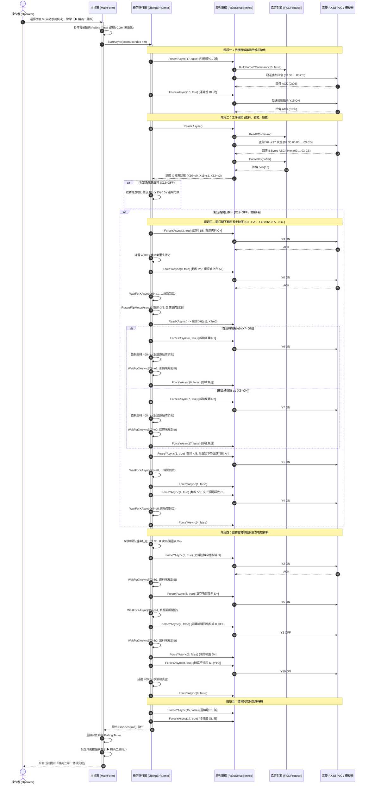
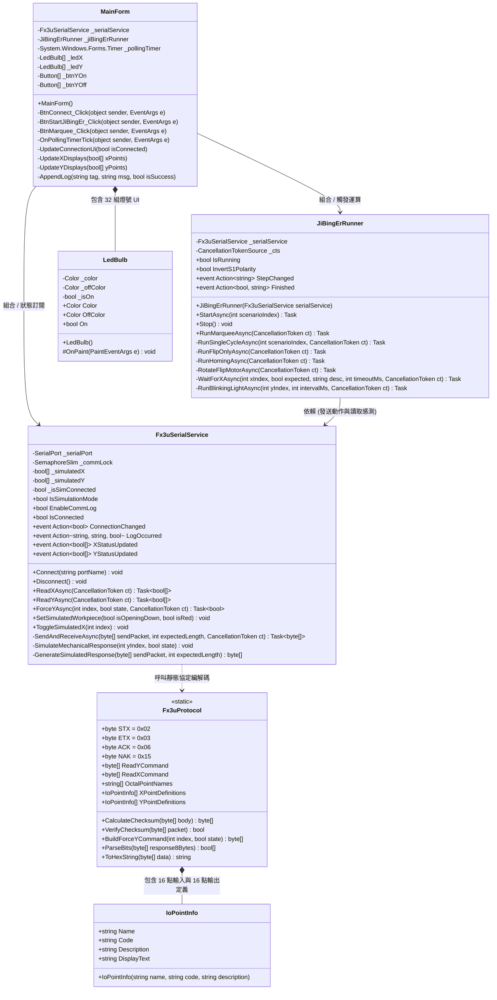
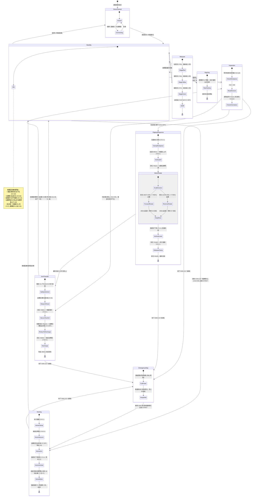
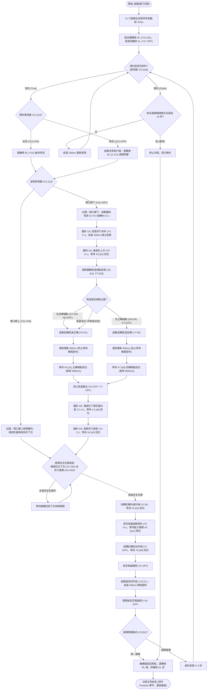

# 三菱 FX3U PLC 串列監控與機電整合第二站自動化系統 (C# Windows Forms)

專為 **Visual Studio 2026** (.NET 9.0 Windows Forms) 開發之工業級三菱 MELSEC-F FX3U PLC 串列監控系統與機電整合丙級第二站（11501）自動化控制平台。

---

## 系統架構與 UML 設計模型

本專案採物件導向與分層解耦架構，GitHub 支援原生 Mermaid 渲染，以下展示系統核心運作之四大 UML 模型：

### 1. 循序圖 (Sequence Diagram) - 單一循環與翻料時序交互

展示主視窗、機丙運行器 (`JiBingErRunner`)、串列通訊服務 (`Fx3uSerialService`)、協定引擎 (`Fx3uProtocol`) 與實體/模擬 PLC 之間的非同步時序交互，涵蓋開口朝下翻料五部曲 ($C+ \rightarrow A+ \rightarrow R1/R2 \rightarrow A- \rightarrow C-$) 與旋臂移載排料：



---

### 2. 類別圖 (Class Diagram) - 模組與物件導向架構

展示 UI 展示層 (`MainForm`、`LedBulb`)、流程控制層 (`JiBingErRunner`)、通訊服務層 (`Fx3uSerialService`) 與協定引擎 (`Fx3uProtocol`、`IoPointInfo`) 之職責劃分與關聯：



---

### 3. 狀態機圖 (State Machine Diagram) - 機構生命週期與模式轉移

描繪機構從開機、待機、急停、復歸、跑馬燈到工作模式的完整狀態轉移：



---

### 4. 活動流程圖 (Activity Diagram) - 核心運動邏輯與安全互鎖

呈現詳細的感測決策路徑、顏色判別、姿勢判別、防原地誤判馬達翻轉與旋臂移載排料：



---

## 專案特性
- **嚴格遵循三菱 FX Programming Port Protocol**：
  - 完整支援 $X0 \sim X17$ 輸入接點即時狀態監控。
  - 完整支援 $Y0 \sim Y17$ 輸出接點即時狀態監控與單點強制 ON/OFF 控制。
  - 正確處理八進制接點高低位 Nibble 映射解碼。
  - 具備 Checksum 檢查碼自動計算與雙向驗證。
- **串列通訊 (SerialPort)**：
  - 固定參數：`BaudRate = 9600`, `DataBits = 7`, `Parity = Even`, `StopBits = 1`。
  - 具備執行緒防衝突鎖定 (`SemaphoreSlim`)，確保自動輪詢與手動按鈕不發生衝突。
  - 自動列舉可用 COM 埠，支援連線/中斷連線與逾時重試。
- **立體質感圓形 LED 指示燈 (`LedBulb`)**：
  - 輸入接點 ($X$)：亮綠色高光指示燈。
  - 輸出接點 ($Y$)：鮮紅色高光指示燈。
  - 支援點擊測試與即時文字顯示。
- **內建離線模擬測試模式 (Simulation Mode)**：
  - 無需實體 PLC 或轉接線，勾選「離線模擬模式」即可完整測試全功能：
    - 點擊任一 $X$ 點即可即時模擬輸入開關訊號切換。
    - 點擊 $Y$ 點「ON」/「OFF」可模擬輸出動作與即時燈號反饋。
- **「機丙二開始」自動程序運行器 (`JiBingErRunner`)**：
  - 專屬整合機電整合丙級第二站（11501）自動程序。
  - 支援單一循環（紅/黑料件、朝上/朝下翻料）、連續循環（自動排料與 10s 無料終止）、指定功能（翻料一次）及自動復歸模式（YL 閃爍 3 秒回原點）。
  - 具備**防原地瞬間誤判機制**與**智慧雙向旋轉翻料**。
- **TX / RX Raw Hex 通訊封包即時日誌視窗**：
  - 語法彩色標示（TX 天藍色、RX 嫩綠色、機丙二進度紫色、系統橘黃色、錯誤紅色）。
  - 自動滾動與一鍵清除功能。

---

## 專案結構
```
11501_fx3u/
├── FX3U_Monitor_Specification.md   # 軟體詳細規格書 (包含所有指令與 Checksum)
├── Fx3uMonitor.slnx                # Visual Studio 2026 方案檔
├── README.md                       # 專案操作指南與說明文件 (含完整 UML)
├── .gitignore                      # 標準 .NET / Visual Studio 忽略規則
├── Fx3uMonitorApp/                 # Windows Forms 主專案 (.NET 9.0-windows)
│   ├── Controls/
│   │   └── LedBulb.cs              # 自繪高品質立體平滑圓形 LED 元件
│   ├── Protocols/
│   │   └── Fx3uProtocol.cs         # FX 編程口通訊協定引擎 (指令組裝/Checksum/解碼)
│   ├── Services/
│   │   ├── Fx3uSerialService.cs    # 串列埠通訊管理、執行緒保護與模擬核心
│   │   └── JiBingErRunner.cs       # 機丙二核心運動控制器 (翻料/移載/跑馬燈)
│   ├── MainForm.cs                 # 主視窗控制邏輯
│   ├── MainForm.Designer.cs        # 工業風 UI 排版
│   └── Program.cs                  # 程式啟動點
├── Fx3uMonitorApp.Tests/           # xUnit 單元測試專案 (44 項自動化驗證測試)
│   ├── ProtocolTests.cs            # 32 條強制指令、讀取指令與 Checksum 驗證
│   └── ServiceTests.cs             # 服務層全流程模擬整合測試 (含翻料時序驗證)
└── md/                             # Markdown 專案詳細文件庫
    ├── FX3U_Monitor_Specification.md
    ├── UML_Architecture_Analysis.md # 四大 UML 架構專題分析報告
    └── walkthrough.md              # 實作進度與歷史歷程回顧
```

---

## 快速開始與編譯執行

### 1. 開發工具
* **Visual Studio 2026**（或 Visual Studio 2022 v17.10+）
* 需安裝工作負載：**.NET 桌面開發 (.NET Desktop Development)**

### 2. 命令列編譯與測試
若您習慣使用命令列，可在本目錄直接執行：

```powershell
# 建置整個解決方案
dotnet build

# 執行所有單元測試與協定驗證 (44 項測試 100% 通過)
dotnet test

# 啟動應用程式
dotnet run --project Fx3uMonitorApp/Fx3uMonitorApp.csproj
```

---

## 指令對照快速查閱

### 1. 讀取指令
- **讀取 $Y0 \sim Y17$**：`02 30 30 30 41 30 30 32 03 36 36`
- **讀取 $X0 \sim X17$**：`02 30 30 30 38 30 30 32 03 35 44`

### 2. 強制控制指令
- 強制 ON 指令碼為 `0x37` ('7')，強制 OFF 指令碼為 `0x38` ('8')。
- 完整 16 組接點十六進制封包已封裝於 `Fx3uProtocol.BuildForceYCommand(index, state)` 中。
