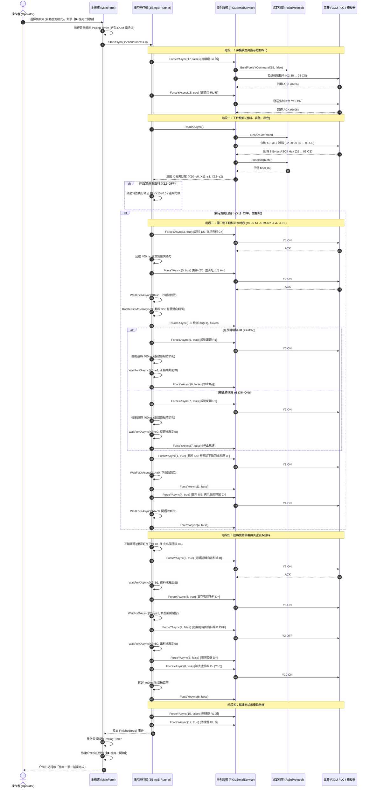
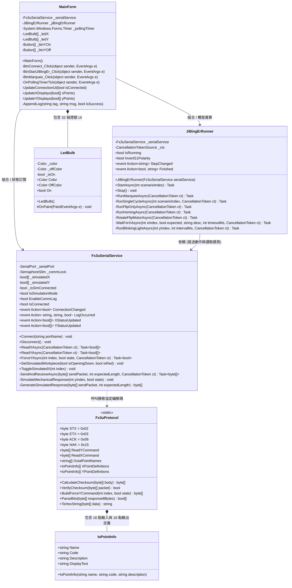
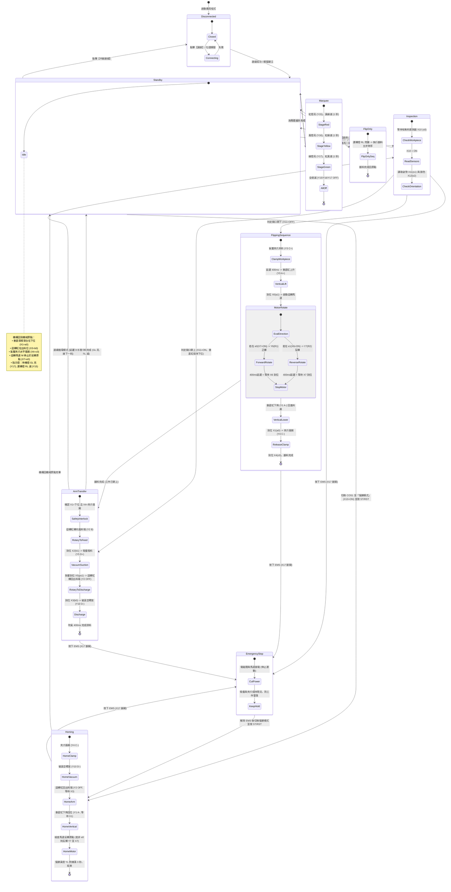
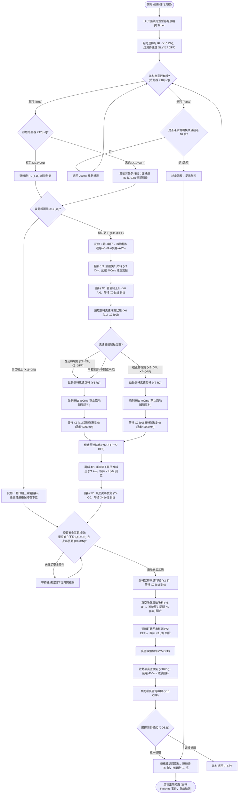

# 三菱 FX3U 機電整合丙級第二站 (11501) 系統架構與 UML 分析報告

本報告針對 **Fx3uMonitorApp (三菱 FX3U PLC 串列監控與機電整合第二站自動化系統)** 進行全面深入的架構分析，並繪製標準 UML 圖形，涵蓋系統交互時序、類別物件結構、機構狀態機轉移以及自動化流程邏輯。

---

## 1. 循序圖 (Sequence Diagram)

此循序圖呈現從操作人員在主介面按下【機丙二開始】後的完整非同步時序交互，包含：
1. UI 停止背景輪詢（獨佔 COM 埠）。
2. `JiBingErRunner` 啟動檢測流程。
3. `Fx3uSerialService` 封包組裝、Checksum 校驗與 PLC 指令傳輸。
4. **開口朝下翻料連鎖保護**（夾料 $Y3 \rightarrow$ 上升 $Y0 \rightarrow$ 智慧翻轉 $Y6/Y7 \rightarrow$ 下降 $Y1 \rightarrow$ 放料 $Y4$）。
5. 旋臂進料 ($Y2$)、吸料 ($Y5$)、出料位移載、破真空排料 ($Y10$) 與指示燈切換。

---

## 2. 類別圖 (Class Diagram)

此類別圖展示軟體架構的分層設計：
- **UI 展示層**：`MainForm` (WinForms)、`LedBulb` (自繪 GDI+ 指示燈)。
- **業務流程層**：`JiBingErRunner` (機電整合第二站自動化流程協調器)。
- **服務層**：`Fx3uSerialService` (執行緒安全通訊、指令重試、離線模擬器)。
- **協定層**：`Fx3uProtocol` (三菱 FX 系列 16 進制 ASCII 協定封包、Checksum、位元拆解)、`IoPointInfo` (點位資訊模型)。

---

## 3. 狀態機圖 (State Machine Diagram)

此狀態機圖描繪機電整合第二站機構從開機、待機、急停、復歸到執行單一循環或跑馬燈的狀態變更生命週期。

---

## 4. 活動流程圖 (Activity Diagram)

此活動流程圖細緻描繪了系統運行【機電整合丙級第二站核心運動邏輯】的決策路徑與並行保護機制。

---

## 5. 模組互動與職責對應表

| 模組名稱 | 檔案路徑 | 核心職責 | 在架構中的關鍵模式 |
| :--- | :--- | :--- | :--- |
| **`MainForm`** | `Fx3uMonitorApp/MainForm.cs` | 使用者操作介面、指示燈更新、定時輪詢管理、控制指令獨佔協調 | View / Controller、Observer (訂閱 Service/Runner 事件) |
| **`JiBingErRunner`** | `Fx3uMonitorApp/Services/JiBingErRunner.cs` | 機丙第二站動作邏輯、翻料五部曲、智慧雙向旋轉、到位保護 | Command / State Pattern (狀態流程協調器) |
| **`Fx3uSerialService`** | `Fx3uMonitorApp/Services/Fx3uSerialService.cs` | 串列埠封裝 (RS-422)、執行緒安全通訊鎖、重試機制、離線氣壓機構模擬器 | Service Layer、Facade、Thread-Safe Proxy |
| **`Fx3uProtocol`** | `Fx3uMonitorApp/Protocols/Fx3uProtocol.cs` | 三菱編程口二進制/ASCII 協定封包構建、Modulo 256 Checksum 校驗、Nibble 位元解碼 | Protocol Parser / Utility Layer |
| **`LedBulb`** | `Fx3uMonitorApp/Controls/LedBulb.cs` | 自繪漸層抗鋸齒立體發光 LED 元件 | Custom UI Control (GDI+ Rendering) |

---

## 6. 結論與亮點回顧

1. **嚴密的物理互鎖**：在旋臂旋轉前嚴格檢查垂直缸下端點 ($X1=a0$) 與夾爪開極限 ($X4=c0$)，避免旋臂與翻料機構在半空中發生物理干涉碰撞。
2. **防原地瞬間誤判機制**：在啟動翻轉馬達時加入強制運動 400ms 延遲，徹底杜絕微動開關在原點未脫離時被軟體在 0 毫秒內誤判「已到位」而直接跳過的致命瑕疵。
3. **智慧雙向翻轉 (`RotateFlipMotorAsync`)**：自動偵測 $X6(e1)$ 與 $X7(e0)$，依機構所在端點彈性驅動 $Y6(R1)$ 或 $Y7(R2)$，完整實現往復雙向翻料。
4. **通訊零衝突保護**：藉由暫停背景 Polling Timer 與 `SemaphoreSlim` 雙重防護，確保連續強制控制指令具備 100% 傳輸優先權與穩定性。
